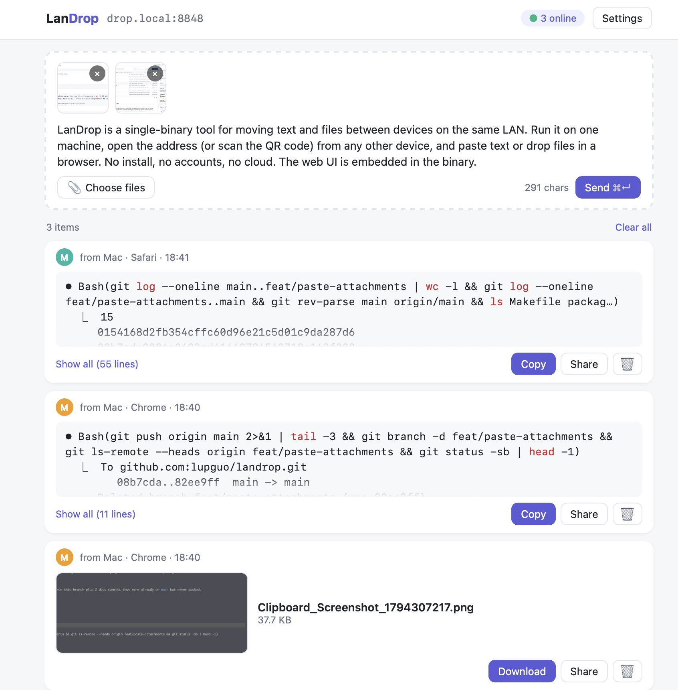
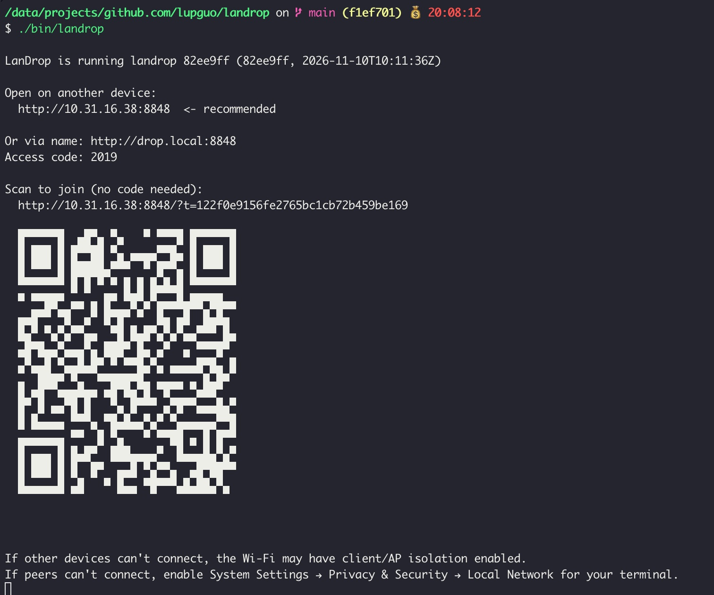

# LanDrop

[中文说明](#中文说明)

<p align="center"> </p>

LanDrop is a single-binary tool for moving text and files between devices on the same LAN. Run it on one machine, open the address (or scan the QR code) from any other device, and paste text or drop files in a browser. No accounts, no cloud. The web UI is embedded in the binary.

## Install

**macOS (Homebrew, recommended)**

```sh
brew install lupguo/tap/landrop
```

Upgrade with `brew upgrade landrop`. The Homebrew cask is macOS-only.

**macOS / Linux (install script)**

```sh
curl -fsSL https://raw.githubusercontent.com/lupguo/landrop/main/scripts/install.sh | sh
```

The script downloads the release for your OS and CPU, verifies its SHA-256 checksum, and installs `landrop` to `/usr/local/bin` if writable, otherwise to `~/.local/bin` (it never uses sudo). Options, set as environment variables:

```sh
curl -fsSL https://raw.githubusercontent.com/lupguo/landrop/main/scripts/install.sh | LANDROP_VERSION=v0.1.0 LANDROP_INSTALL_DIR="$HOME/bin" sh
```

- `LANDROP_VERSION`: tag to install (default: latest release)
- `LANDROP_INSTALL_DIR`: install directory

Piping a script into a shell runs whatever it contains: you can read [scripts/install.sh](scripts/install.sh) first, or download it and run it yourself.

**Windows (PowerShell)**

```powershell
irm https://raw.githubusercontent.com/lupguo/landrop/main/scripts/install.ps1 | iex
```

Installs `landrop.exe` to `%LOCALAPPDATA%\Programs\landrop` and adds it to your user PATH (open a new terminal afterwards). To pin a version, set `$env:LANDROP_VERSION = "v0.1.0"` first. Read [scripts/install.ps1](scripts/install.ps1) before piping it to `iex` if you want to check it.

**Manual download**

Download the archive for your platform from the [Releases page](https://github.com/lupguo/landrop/releases), together with `checksums.txt`:

- `landrop_darwin_arm64.tar.gz`, `landrop_darwin_amd64.tar.gz`
- `landrop_linux_amd64.tar.gz`, `landrop_linux_arm64.tar.gz`
- `landrop_windows_amd64.zip`

Verify it, then extract and put `landrop` somewhere on your PATH:

```sh
shasum -a 256 -c checksums.txt --ignore-missing     # macOS
sha256sum -c --ignore-missing checksums.txt         # Linux
```

```powershell
# Windows: compare the output with the matching line in checksums.txt
Get-FileHash -Algorithm SHA256 .\landrop_windows_amd64.zip
```

Check the installed version with `landrop --version` (prints `landrop v0.1.0 (<commit>, <date>)`).

Maintainers: see [docs/release-setup.md](docs/release-setup.md) (Chinese) for how releases are set up.

## Quick start

```sh
landrop
```

The terminal prints the LAN addresses, a 4-digit access code and a QR code. Open the address on another device, enter the code, and paste text or drop files. A device that scans the QR code (or opens the `?t=` link) joins without typing the code.

## Flags

```
Usage:
  landrop [flags]           start the LanDrop server
  landrop send <file>|-     send a file (or stdin with -) to the running server

Flags:
  --dir string       directory to share read-only for browsing
  --keep             keep temporary files on exit
  --lang string      terminal language: en|zh|ja|ko (env LANDROP_LANG) (default "en")
  --max-size string  maximum file size, e.g. 512MB or 4GB (default "4GB")
  --name string      mDNS name, reachable as <name>.local (default "drop")
  --no-auth          disable the access code (anyone on the network can join)
  --no-open          do not open the browser on start
  --no-save          do not autosave received files to ~/Downloads/LanDrop
  --port int         listen port; tries the next one if busy, up to 10 times (default 9958)
  --ttl duration     how long items are kept (default 24h0m0s)
  --version          print the version and exit
  -h, --help         show this help
```

## Sending from the command line

With LanDrop running on this machine:

```sh
landrop send ./report.pdf          # send a file
cat app.log | landrop send -       # send stdin (text up to 1 MiB becomes a message, larger input a file)
```

## Code signing

- **macOS**: release binaries are signed and notarized by Apple. The first run needs an internet connection so macOS can check the notarization online; this is normal.
- **Windows**: the binary is not code-signed, so SmartScreen may warn. Click "More info", then "Run anyway".

## Network notes

- **Windows firewall**: allow inbound TCP on the port (run in an elevated prompt):
  `netsh advfirewall firewall add rule name="LanDrop" dir=in action=allow protocol=TCP localport=9958`
- **macOS Local Network permission**: on first run macOS may ask whether the terminal app may find devices on your local network. Allow it, or other devices (and `<name>.local`) cannot reach LanDrop. It can be changed in System Settings > Privacy & Security > Local Network.
- **AP / client isolation**: if other devices cannot connect, check that the router or guest Wi-Fi does not have "AP isolation" / "client isolation" enabled; it blocks device-to-device traffic.
- `drop.local` (mDNS) may not resolve on every network; use the IP address printed in the banner.

## Security notes

- LanDrop speaks plain HTTP on your LAN. Anyone who can sniff the network can see traffic. Use it only on networks you trust.
- Access is gated by a 4-digit code. Five consecutive wrong attempts lock that IP for 60 seconds, and more than 30 failures overall within a minute lock all code attempts for 60 seconds. Existing sessions and QR/token links are unaffected.
- Share links are one-time by default (1 download, 10 minutes); invalid or used links return HTTP 410. Message (text + attachments) links have no download limit and work until they expire.
- `--no-auth` disables the code entirely: anyone on the network can view, send and download. Use it only on networks you fully trust.
- Only the host machine (loopback) can remove other devices.

## Build from source

Requires Go 1.26 and Node 22.

```sh
make all     # web UI + bin/landrop
./bin/landrop
make test    # Go and web unit tests
make e2e     # Playwright smoke test (needs: cd web && npx playwright install chromium)
make dist    # cross-compile darwin/arm64, darwin/amd64, windows/amd64, linux/amd64, linux/arm64 into dist/
make release-snapshot   # local dry run of the release build (goreleaser, no publishing)
```

---

## 中文说明

<p align="center"> </p>

LanDrop 是一个单文件工具，用于在同一局域网内的设备之间传文本和文件。在一台机器上运行，在其他设备的浏览器里打开地址（或扫码），即可粘贴文本、拖入文件。无账号、不经过云端；Web 界面已内嵌在二进制中。

### 安装

**macOS（Homebrew，推荐）**

```sh
brew install lupguo/tap/landrop
```

升级：`brew upgrade landrop`。Homebrew cask 仅适用于 macOS。

**macOS / Linux（安装脚本）**

```sh
curl -fsSL https://raw.githubusercontent.com/lupguo/landrop/main/scripts/install.sh | sh
```

脚本会按系统和 CPU 下载对应版本，校验 SHA-256，然后安装到 `/usr/local/bin`（不可写时安装到 `~/.local/bin`，脚本从不使用 sudo）。可用环境变量：

```sh
curl -fsSL https://raw.githubusercontent.com/lupguo/landrop/main/scripts/install.sh | LANDROP_VERSION=v0.1.0 LANDROP_INSTALL_DIR="$HOME/bin" sh
```

- `LANDROP_VERSION`：指定版本标签（默认最新版）
- `LANDROP_INSTALL_DIR`：安装目录

把脚本直接管道给 shell 执行意味着运行其中的全部内容，建议先阅读 [scripts/install.sh](scripts/install.sh)，或下载后自行运行。

**Windows（PowerShell）**

```powershell
irm https://raw.githubusercontent.com/lupguo/landrop/main/scripts/install.ps1 | iex
```

安装 `landrop.exe` 到 `%LOCALAPPDATA%\Programs\landrop` 并加入用户 PATH（之后请新开终端）。如需指定版本，先设置 `$env:LANDROP_VERSION = "v0.1.0"`。想先检查脚本，请阅读 [scripts/install.ps1](scripts/install.ps1)。

**手动下载**

从 [Releases 页面](https://github.com/lupguo/landrop/releases) 下载对应平台的压缩包和 `checksums.txt`：

- `landrop_darwin_arm64.tar.gz`、`landrop_darwin_amd64.tar.gz`
- `landrop_linux_amd64.tar.gz`、`landrop_linux_arm64.tar.gz`
- `landrop_windows_amd64.zip`

校验后解压，把 `landrop` 放到 PATH 中的目录：

```sh
shasum -a 256 -c checksums.txt --ignore-missing     # macOS
sha256sum -c --ignore-missing checksums.txt         # Linux
```

```powershell
# Windows：将输出与 checksums.txt 中对应行比对
Get-FileHash -Algorithm SHA256 .\landrop_windows_amd64.zip
```

安装后可用 `landrop --version` 查看版本（输出 `landrop v0.1.0 (<commit>, <date>)`）。

维护者请参阅 [docs/release-setup.md](docs/release-setup.md)（中文）了解发布配置。

### 快速开始

```sh
landrop            # 加 --lang zh 可让终端输出中文
```

终端会显示局域网地址、4 位访问码和二维码。其他设备打开地址并输入访问码即可；扫码或打开带 `?t=` 的链接则无需输入访问码。

### 命令行发送

```sh
landrop send ./report.pdf
cat app.log | landrop send -
```

参数列表见上方 Flags（`landrop --help --lang zh` 可看中文说明）。

### 代码签名

- **macOS**：发布的二进制已签名并经 Apple 公证。首次运行需要联网，macOS 会在线校验公证状态，这是正常现象。
- **Windows**：二进制未做代码签名，SmartScreen 提示时点击"更多信息"，再点"仍要运行"。

### 网络提示

- **Windows 防火墙**：以管理员身份执行 `netsh advfirewall firewall add rule name="LanDrop" dir=in action=allow protocol=TCP localport=9958`。
- **macOS 本地网络权限**：首次运行时请允许终端访问本地网络，否则其他设备无法连接。
- **AP / 客户端隔离**：如果其他设备连不上，请检查路由器或访客 Wi-Fi 是否开启了"AP 隔离"。

### 安全说明

- 局域网内使用明文 HTTP，请只在可信网络中使用。
- 访问码为 4 位数字；同一 IP 连续输错 5 次锁定 60 秒，全局 1 分钟内失败超过 30 次则暂停所有输码尝试 60 秒。
- 分享链接默认一次有效（1 次下载、10 分钟），失效返回 HTTP 410。消息（文字 + 附件）的分享链接不限下载次数，在过期前一直有效。
- `--no-auth` 会关闭访问码，网络内任何人都能查看和发送，请谨慎使用。

### 从源码构建

需要 Go 1.26 和 Node 22：`make all` 后运行 `./bin/landrop`；测试 `make test`；冒烟测试 `make e2e`；交叉编译 `make dist`；本地发布演练 `make release-snapshot`。
